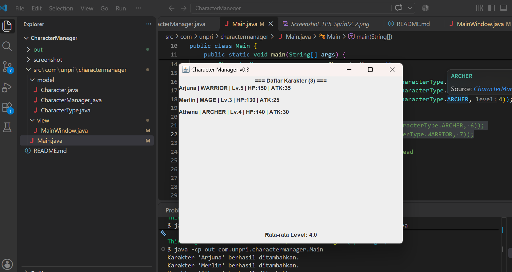
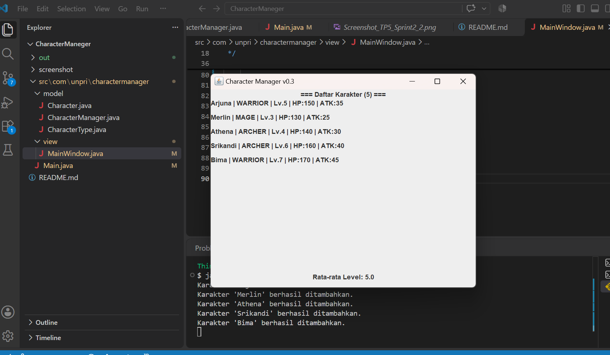

# CHARACTER MANAGER – TP8
## Sprint #3: MainWindow, Data Dinamis & Analisis MVC

### 1. Deskripsi Project

Character Manager merupakan aplikasi berbasis Java yang dikembangkan menggunakan Java Swing. Aplikasi ini digunakan untuk menampilkan daftar karakter secara dinamis melalui Graphical User Interface (GUI). Pada TP8, aplikasi dikembangkan dengan menerapkan konsep Event-Driven Programming dan prinsip MVC (Model-View-Controller).

### 2. Screenshot Aplikasi

**A. Sebelum Penambahan Karakter (3 Karakter)**

**B. Sesudah Penambahan Karakter (5 Karakter)**

**B. Sesudah Penambahan Karakter (5 Karakter)**

Alamat file:
`screenshot/Screenshot_AP10_Sesudah.png`

### 3. Alur Data dan Penerapan MVC

Pada aplikasi ini, `Main.java` berfungsi sebagai titik awal program yang membuat objek `CharacterManager` dan menambahkan data karakter. `CharacterManager` berperan sebagai bagian Model yang mengelola data karakter serta menghitung rata-rata level. Selanjutnya, data karakter dan hasil perhitungan rata-rata diberikan kepada `MainWindow.java` untuk ditampilkan melalui komponen JLabel. Pemisahan pengelolaan data dan tampilan ini membantu menerapkan prinsip MVC sehingga program lebih terstruktur dan mudah dikembangkan.

### 4. Karakter Baru

Pada TP8, terdapat dua karakter baru yang ditambahkan:

| Nama Karakter | Tipe | Level | Alasan Pemilihan |
|---|---|---:|---|
| Srikandi | ARCHER | 6 | Dipilih sebagai karakter pemanah yang memiliki kemampuan menyerang dari jarak jauh. |
| Bima | WARRIOR | 7 | Dipilih sebagai karakter petarung yang memiliki kekuatan dan kemampuan bertahan. |

### 5. Analisis GUI dan MVC

https://docs.google.com/document/d/1C5xtZOWdQmej3NW3K-TW6Vq1Yfk8pEGkuPadXgzA4cA/edit?usp=sharing

### 6. Kesimpulan

Melalui TP8, aplikasi Character Manager berhasil dikembangkan menggunakan Java Swing. Aplikasi dapat menampilkan data karakter secara dinamis dan menghitung rata-rata level secara otomatis. Praktik ini memberikan pemahaman mengenai GUI, Event-Driven Programming, penggunaan SwingUtilities.invokeLater(), serta penerapan prinsip MVC dalam pengembangan aplikasi Java.