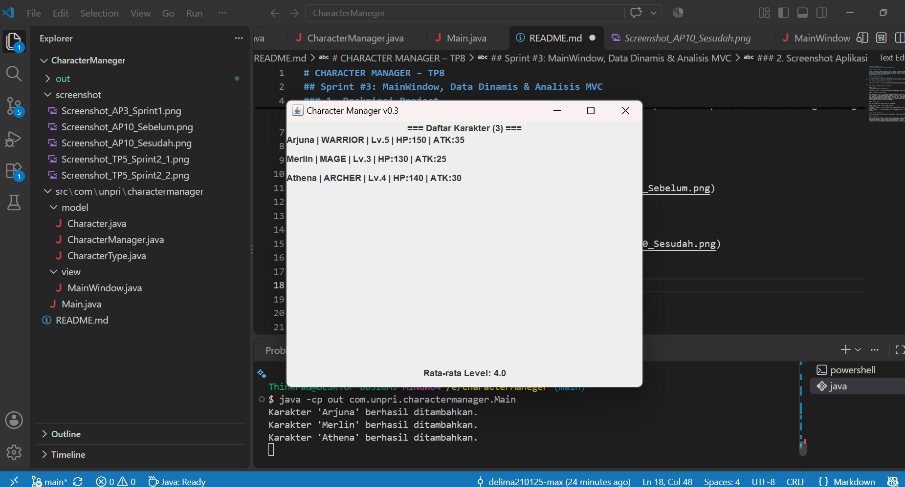
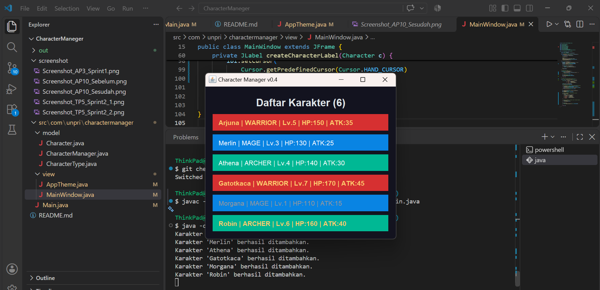

# TP10 – Character Manager Sprint #4
## Theming, Properti Komponen, dan Analisis MVC

---

## A. Deskripsi Proyek

Character Manager merupakan aplikasi berbasis Java Swing yang digunakan untuk menampilkan dan mengelola data karakter. Pada TP10 Sprint #4, aplikasi dikembangkan dengan menerapkan tema tampilan terpusat melalui kelas `AppTheme`, penggunaan warna berdasarkan jenis karakter, serta pengaturan properti komponen.

Pengembangan ini bertujuan menghasilkan tampilan aplikasi yang lebih menarik, konsisten, mudah dipelihara, dan menerapkan prinsip arsitektur MVC (Model-View-Controller).

## B. Screenshot Sebelum Pengembangan (v0.3)

Berikut merupakan tampilan aplikasi sebelum pengembangan TP10 dengan tiga karakter.

## C. Screenshot Sesudah Pengembangan (v0.4)

Berikut merupakan tampilan aplikasi setelah penerapan tema, penambahan karakter, dan pengaturan properti komponen.

## D. Implementasi AppTheme

Warna tampilan aplikasi disimpan di kelas `AppTheme`, bukan di kelas `Character`, karena warna merupakan bagian dari tampilan antarmuka pengguna. Kelas `Character` berada pada bagian Model yang bertugas menyimpan data karakter. Dengan memisahkan pengaturan warna ke dalam `AppTheme`, tampilan aplikasi dapat diubah tanpa mengubah data karakter. Pemisahan ini juga membuat kode lebih terstruktur, mudah dipelihara, dan sesuai dengan prinsip MVC.

## E. Properti Komponen Tambahan

Pada pengembangan TP10, terdapat dua properti komponen tambahan:

1. **ToolTipText:** Digunakan untuk menampilkan informasi detail karakter, seperti nama, role, level, HP, dan ATK ketika pengguna mengarahkan kursor ke komponen karakter. Properti ini membantu pengguna memperoleh informasi tambahan tanpa memenuhi tampilan utama.

2. **setEnabled(false):** Digunakan untuk membuat karakter dengan level 1 menjadi nonaktif. Properti ini memberikan perbedaan visual pada karakter yang masih berada di level awal.

## F. Teknologi yang Digunakan

- Java
- Java Swing
- Visual Studio Code
- Git dan GitHub
- Arsitektur MVC

## G. Google Docs – Analisis Bagian D

**Judul Dokumen:** JavaVisual_TP10_253303621223_Putri_Delimayanti_Sumbayak

**Link Google Docs:**

[TEMPEL_LINK_GOOGLE_DOCS_LENGKAP_DI_SINI](https://docs.google.com/document/d/1t08-HQHhyWuD9I2Mx3M6D8enJuU3NmblXMFITLmHND4/edit?usp=sharing)

## H. Kesimpulan

Melalui TP10 Character Manager Sprint #4, aplikasi dikembangkan dengan pengaturan tema terpusat, penggunaan warna berdasarkan jenis karakter, serta penambahan properti komponen. Pengembangan ini meningkatkan pemahaman mengenai Java Swing, pengaturan tampilan, penggunaan JavaBeans, dan penerapan prinsip MVC dalam aplikasi Java.