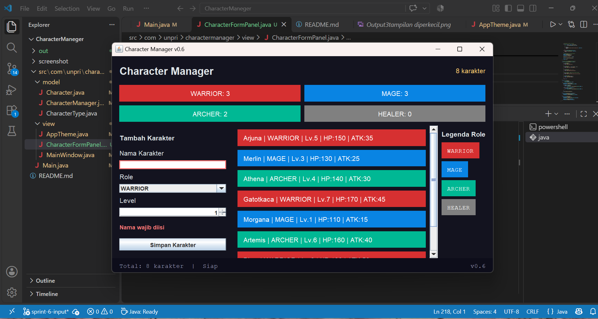
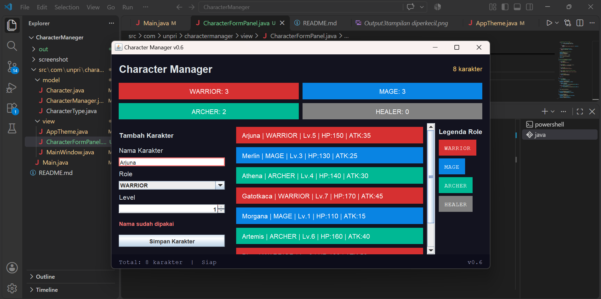
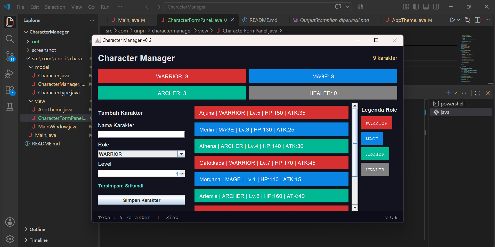

# Java Visual TP14 – AP19
## Character Manager Sprint #6: Form Input, Validasi & Analisis MVC

## Identitas

- **Nama:** Putri Delimayanti Sumbayak
- **NIM:** 253303621223
- **Program Studi:** Sistem Informasi
- **Mata Kuliah:** Java Visual (SIH-6406)
- **Tugas:** TP14 – AP19
- **Sprint:** Sprint #6

---

## 1. Deskripsi Tugas

TP14 merupakan pengembangan aplikasi Character Manager pada Sprint #6. Pengembangan ini berfokus pada pembuatan form input karakter, validasi data, serta penerapan prinsip Model-View-Controller (MVC).

Pengguna dapat menambahkan karakter melalui form dengan mengisi nama, memilih role, dan menentukan level karakter. Sistem melakukan pemeriksaan input sebelum karakter disimpan ke dalam daftar.

## 2. Fitur yang Dikembangkan

### 2.1 Form Input Karakter
- JTextField untuk memasukkan nama karakter.
- JComboBox untuk memilih jenis karakter.
- JSpinner untuk menentukan level 1–99.

### 2.2 Validasi Nama
- Nama wajib diisi.
- Panjang nama minimal 3 dan maksimal 20 karakter.
- Nama hanya boleh menggunakan huruf dan spasi.
- Tidak boleh menggunakan spasi berulang.
- Nama tidak boleh duplikat.

### 2.3 Validasi Model
- Nama tidak boleh kosong.
- Role wajib dipilih.
- Level harus berada pada rentang 1–99.
- Role MAGE memiliki batas maksimal level 60.

### 2.4 Aturan Tambahan
- Jumlah karakter maksimal 20.
- Pesan kesalahan ditampilkan pada form.
- Karakter yang berhasil ditambahkan langsung muncul pada daftar.

## 3. Screenshot Pengujian

### A. Validasi Nama Kosong

### B. Validasi Nama Duplikat

### C. Berhasil Menambahkan Karakter

## 4. Tabel Pengujian

| No. | Input Pengujian | Hasil yang Diharapkan | Hasil Aktual | Lapisan |
|---|---|---|---|---|
| 1 | Nama kosong | Ditolak, muncul pesan Nama wajib diisi | Sesuai | View |
| 2 | Nama arjuna | Ditolak karena nama sudah digunakan | Sesuai | View |
| 3 | Srikandi, ARCHER, level 5 | Karakter berhasil ditambahkan | Sesuai | View dan Model |
| 4 | Nama Ab | Ditolak karena panjang kurang dari 3 karakter | Sesuai | View |
| 5 | Nama Arjuna123 | Ditolak karena mengandung angka | Sesuai | View |
| 6 | Nama Bima  Sakti | Ditolak karena spasi berulang | Sesuai | View |
| 7 | MAGE dengan level 61 | Ditolak karena MAGE maksimal level 60 | Sesuai | Model |
| 8 | Menambahkan karakter ke-21 | Ditolak karena maksimal 20 karakter | Sesuai | Model |

**Catatan:** Hasil aktual pada tabel diisi berdasarkan pengujian aplikasi.

## 5. Catatan Implementasi

Pada pengembangan ini, ActionListener masih digunakan secara sederhana untuk menangani tombol simpan dan tombol Enter pada kolom nama. Selain itu, View masih memanggil manager.addCharacter() secara langsung untuk menambahkan karakter. Kedua hal tersebut merupakan kompromi sementara agar fitur dapat berjalan sesuai kebutuhan tugas. Pada pengembangan berikutnya, struktur komunikasi antarkomponen akan dirapikan agar pemisahan tanggung jawab MVC menjadi lebih baik.

## 6. Analisis MVC

Analisis mengenai validasi input, pemisahan tanggung jawab View dan Model, penanganan kesalahan, serta penerapan komponen Swing dijelaskan lebih lengkap dalam dokumen Google Docs berikut.

**Link Google Docs Analisis MVC:**

https://docs.google.com/document/d/1-PDwmMjQHvT3_ENYoEpNprBPN90ALM0NPc4h3Ziwgw0/edit?usp=sharing

## 7. Kesimpulan

Melalui TP14, aplikasi Character Manager telah dikembangkan dengan form input dan validasi yang lebih terstruktur. Penerapan validasi pada View dan Model membantu menjaga agar data karakter yang disimpan sesuai dengan aturan aplikasi. Pengembangan ini juga memberikan pemahaman mengenai pentingnya pemisahan tanggung jawab dalam konsep MVC.